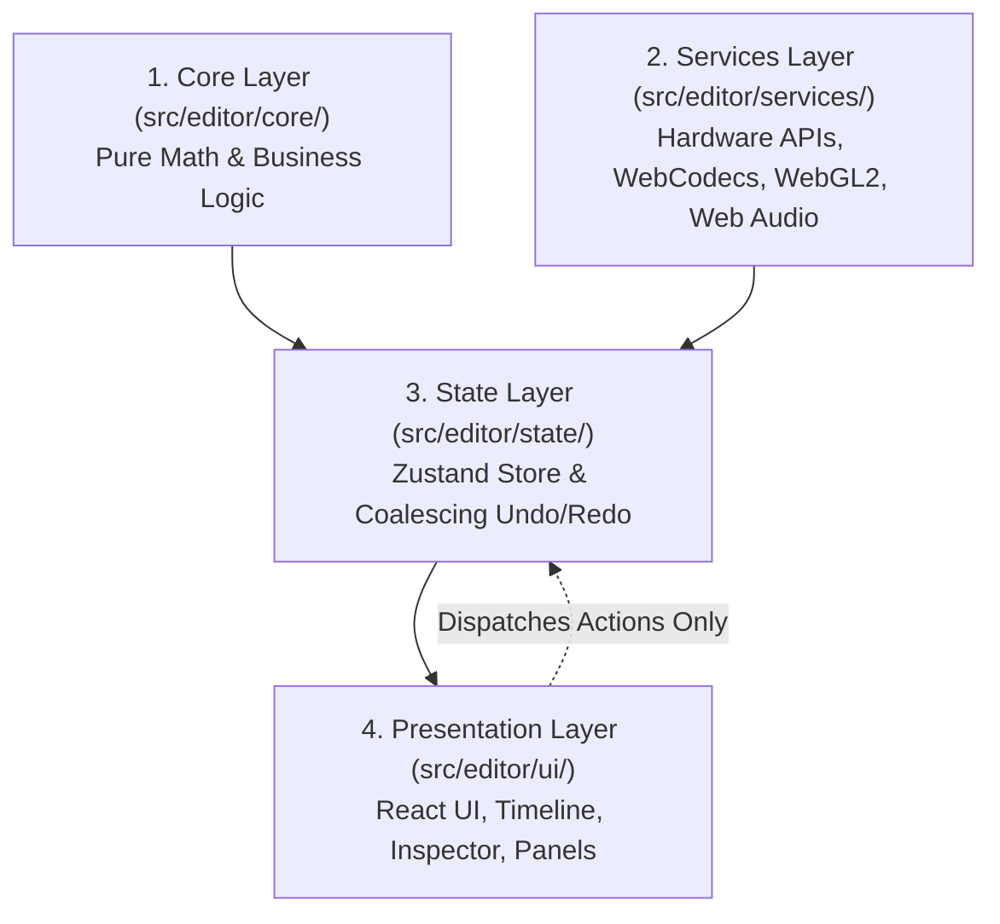
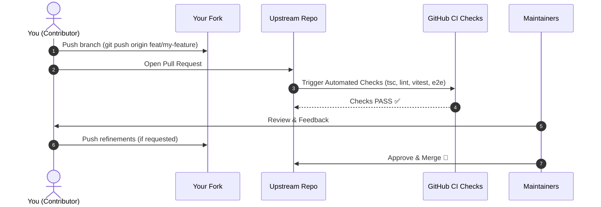

<div align="center">

# 🤝 Contributing to The Free Video Editor

### _Thank you for helping build the future of free, private, web-native video editing!_

[](./CONTRIBUTING.md)
[](https://github.com/GajananPalepwad/TheFreeVideoEditor/issues)
[](https://www.contributor-covenant.org/version/2/1/code_of_conduct/)

<p align="center">
  <a href="#-code-of-conduct"><strong>Code of Conduct</strong></a> •
  <a href="#-where-can-i-help"><strong>Where Can I Help?</strong></a> •
  <a href="#-getting-started"><strong>Getting Started</strong></a> •
  <a href="#-architectural-principles--invariants"><strong>Architecture</strong></a> •
  <a href="#-development-workflow"><strong>Dev Workflow</strong></a> •
  <a href="#-submitting-a-pull-request"><strong>PR Checklist</strong></a>
</p>

</div>

---

We welcome contributions from developers, video editors, designers, and technical writers of all backgrounds and experience levels. Whether you are fixing a small CSS glitch, crafting a WebGL shader transition, tuning audio DSP equations, or improving documentation, every contribution makes an impact.

---

## 📜 Code of Conduct

We are committed to providing a welcoming, inclusive, harassment-free, and respectful environment for everyone.

- **Be Respectful**: Treat fellow contributors, maintainers, and community members with empathy and kindness.
- **Constructive Communication**: Focus on constructive feedback, collaborative problem-solving, and shared learning.
- **Inclusivity**: Welcome beginners and experienced developers alike.

---

## 🧭 Where Can I Help?

Find an area that matches your skills and passions:

| Domain                    | Key Technologies                         | What You Can Work On                                                                                            |
| :------------------------ | :--------------------------------------- | :-------------------------------------------------------------------------------------------------------------- |
| 🎨 **UI / UX & React**    | React 19, Tailwind CSS, Radix UI, Lucide | Timeline controls, inspector panels, color pickers, modal dialogs, keyboard navigation, and responsive layouts. |
| 🧪 **WebGL2 & Shaders**   | WebGL2, GLSL, Shaders, Canvas2D          | Real-time transitions, blend modes, LUT color grading, motion graphics, and chroma key (green screen).          |
| 🔊 **Audio & DSP**        | Web Audio API, Biquad Filters            | Parametric EQ visualizers, dynamic compressors, limiter algorithms, audio ducking, and stereo metering.         |
| 📐 **Core Math & Engine** | Pure TypeScript, Zod, Microsecond Math   | Non-destructive timeline operations, collision detection, ripple edits, snapping, and marker range logic.       |
| 🤖 **AI & Speech**        | Transformers.js, ONNX, WebGPU            | On-device Whisper AI speech-to-text models, word synchronization, and animated subtitle presets.                |
| 🔄 **Interchange & I/O**  | XML, OTIO, WebCodecs, OPFS               | Final Cut Pro XML (`FCPXML`), OpenTimelineIO (`OTIO`), EDL, MP4 muxing, and high-performance video export.      |
| 📝 **Docs & Tutorials**   | Markdown, Astro, Technical Writing       | Video editing guides, shortcut documentation, API references, and feature walkthroughs.                         |

---

## 🚀 Getting Started

### Prerequisites

Before you start, make sure you have installed:

- **Node.js**: `>= 22.12.0` (LTS recommended)
- **Package Manager**: `npm` (`v10+`)
- **Modern Web Browser**: Google Chrome 120+, Microsoft Edge 120+, or Apple Safari 17.4+

### Setup in 4 Steps

```bash
# 1. Fork the repository on GitHub, then clone your fork locally:
git clone https://github.com/<your-username>/TheFreeVideoEditor.git
cd TheFreeVideoEditor

# 2. Add the upstream repository remote to stay synchronized:
git remote add upstream https://github.com/GajananPalepwad/TheFreeVideoEditor.git

# 3. Install project dependencies:
npm install

# 4. Start the local development server:
npm run dev
```

Open [**http://localhost:4321**](http://localhost:4321) in your browser. Navigating to `/editor` launches the full editing suite.

> [!NOTE]
> **Deployment Access**: Deployment keys and Cloudflare Workers production hosting are restricted to core maintainers. Contributors do not need deployment access; all development and verification are done locally via `npm run dev`, `npm test`, and `npm run preview`.

---

## 📐 Architectural Principles & Invariants

To keep the application fast, deterministic, and maintainable, our codebase enforces strict architectural layer boundaries. Please review these rules before submitting code:



### Layer Separation Rules

#### 1. `src/editor/core/` — Pure Business Logic & Math

- **Role**: Pure data models, microsecond timeline math, collision resolution, and file serialization.
- **Rule**: **Zero UI or Browser API dependencies.** Never import React, hooks, DOM elements, WebCodecs, or WebGL into `core/`. Core functions must remain 100% deterministic and unit-testable in Node.js.

#### 2. `src/editor/services/` — Hardware & Browser Services

- **Role**: WebCodecs video decoders/encoders, WebGL2 compositors, Web Audio DSP graph, OPFS file storage, and Web Workers.
- **Rule**: Clean resource lifecycles. Always implement `dispose()` or `close()` methods to release GPU textures, AudioBuffers, and worker threads to prevent memory leaks.

#### 3. `src/editor/state/` — Application State Management

- **Role**: Zustand reactive state store and undo/redo history stacks.
- **Rule**: Mutations must be atomic, serializable, and predictable. Group high-frequency continuous mutations (like dragging sliders) with action coalescing.

#### 4. `src/editor/ui/` — Presentation Layer

- **Role**: React components, virtualized timeline views, inspector inputs, canvas monitors, and modals.
- **Rule**: Keep components thin. Delegate timeline and project calculations to `core/` and state changes to `state/`.

---

### Core Engineering Invariants

> [!IMPORTANT]
> **Every contribution must respect these invariants:**
>
> 1. **Non-destructive Editing**: Raw media files are never altered on disk. Edits are non-destructive representations over media references.
> 2. **Track Overlap Invariant**: Clips placed on the same track must not overlap unless explicitly governed by a transition.
> 3. **Zero Frame Drift**: Time calculations must use exact microsecond integers (`1,000,000 µs = 1s`) or rational numbers to prevent floating-point drift over long projects.
> 4. **100% Client-Side Privacy**: All processing, AI transcription, video decoding, and MP4 rendering must execute strictly on the client machine. No user media or telemetry may ever be transmitted to external servers.

---

## 🛠️ Development Workflow

### 1. Branch Naming Conventions

Create a topic branch branched off the latest `main`:

```bash
git checkout -b feat/add-magnetic-timeline
# or
git fix/webcodecs-decoder-stall
```

Use standard prefixes:

- `feat/` for new features or capabilities
- `fix/` for bug fixes and patches
- `perf/` for performance optimizations
- `docs/` for documentation improvements
- `refactor/` for code refactoring with no behavioral change

---

### 2. Commit Message Standards

We follow the [Conventional Commits](https://www.conventionalcommits.org/) specification:

```text
<type>(<scope>): <short description>
```

| Type       | When to Use              | Example                                                                  |
| :--------- | :----------------------- | :----------------------------------------------------------------------- |
| `feat`     | Adding a new feature     | `feat(inspector): add text shadow controls and blur keyframing`          |
| `fix`      | Resolving a bug          | `fix(timeline): prevent clip collision during magnetic ripple edit`      |
| `perf`     | Optimizing performance   | `perf(render): reuse WebGL framebuffers during canvas playback`          |
| `test`     | Adding or updating tests | `test(audio): add unit tests for 3-band parametric EQ biquad filters`    |
| `docs`     | Documentation changes    | `docs(readme): add browser compatibility matrix and shortcut cheatsheet` |
| `refactor` | Code restructuring       | `refactor(state): modularize sequence-scoped editing actions`            |

---

### 3. Quality Assurance Checks

Before creating a pull request, run the automated verification suite:

```bash
# 1. Typecheck the entire codebase
npx tsc --noEmit

# 2. Run unit and property tests (Vitest)
npm test

# 3. Run ESLint code checks
npm run lint

# 4. Check formatting with Prettier
npx prettier --check .

# 5. Run end-to-end browser tests (Playwright)
npm run test:e2e
```

---

## 📋 Pull Request Checklist

When you are ready to open your pull request, please make sure you have:

- [ ] Forked the repository and created your branch from `main`.
- [ ] Run `npm install` to ensure dependencies are in sync.
- [ ] Kept business logic isolated in `src/editor/core/` without UI dependencies.
- [ ] Preserved all core invariants (zero frame drift, non-destructive editing, client-side privacy).
- [ ] Verified that `npx tsc --noEmit` reports **0 errors**.
- [ ] Verified that `npm test` passes all unit and property tests.
- [ ] Included unit tests or Playwright E2E tests for new functionality.
- [ ] Added clear before-and-after screenshots or screen recordings for any UI changes.
- [ ] Linked any related GitHub issues (`Fixes #123`).

---

## 🗺️ Pull Request Lifecycle



---

## 💬 Community & Questions

Need help or have ideas? We'd love to chat!

- 💡 **Open an Issue**: For feature proposals, bug reports, and discussion, open a [GitHub Issue](https://github.com/GajananPalepwad/TheFreeVideoEditor/issues).
- 📖 **Read the Guides**: Technical architecture guides and RFCs live in [`docs/`](./docs/).

Thank you for contributing to **The Free Video Editor**! 🎬✨
