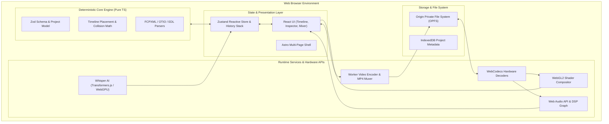

<div align="center">

# 🎬 The Free Video Editor

### _A professional, 100% free, private, web-native non-linear video editing suite._

[](./LICENSE)
[](https://www.typescriptlang.org/)
[](https://astro.build)
[](https://react.dev)
[](https://w3c.github.io/webcodecs/)
[](https://developer.mozilla.org/en-US/docs/Web/API/WebGL2RenderingContext)
[](./CONTRIBUTING.md)
[](https://discord.gg/6MtmjsA53V)
[](https://buymeacoffee.com/beestack)

<p align="center">
  <a href="#-key-features"><strong>Explore Features</strong></a> •
  <a href="#-quickstart"><strong>Quickstart</strong></a> •
  <a href="#-keyboard-shortcuts"><strong>Shortcuts</strong></a> •
  <a href="#-community"><strong>Community</strong></a> •
  <a href="#-architecture"><strong>Architecture</strong></a> •
  <a href="./docs/"><strong>Documentation</strong></a> •
  <a href="./CONTRIBUTING.md"><strong>Contribute</strong></a>
</p>

</div>

---

**The Free Video Editor (TFVE)** is an open-source, full-featured desktop-class non-linear video editor that runs entirely inside your modern web browser. **Your media never leaves your computer**—no cloud uploads, no server queues, no subscriptions, and zero watermarks.

> [!NOTE]
> Powered by cutting-edge Web standards: **WebCodecs** for ultra-fast hardware decoding and encoding, **WebGL2** for 60fps GPU compositing and GLSL shaders, **Web Audio API** for real-time DSP mixing, and the **Origin Private File System (OPFS)** for high-throughput zero-latency storage.

---

## 📑 Table of Contents

- [✨ Key Features](#-key-features)
- [🌐 Browser Compatibility](#-browser-compatibility)
- [🚀 Quickstart](#-quickstart)
- [⌨️ Keyboard Shortcuts](#-keyboard-shortcuts)
- [🏗️ System Architecture](#️-system-architecture)
- [🗂️ Project Structure](#️-project-structure)
- [🧪 Testing & Quality Assurance](#-testing--quality-assurance)
- [📦 Building & Production](#-building--production)
- [📚 Deep-Dive Documentation](#-deep-dive-documentation)
- [☕ Support the Project](#-support-the-project)
- [💬 Community](#-community)
- [🤝 Contributing](#-contributing)
- [📄 License](#-license)

---

## ✨ Key Features

| Capability                         | Highlights                                                                                                                                                                                                  |
| :--------------------------------- | :---------------------------------------------------------------------------------------------------------------------------------------------------------------------------------------------------------- |
| 🔒 **100% Client-Side Privacy**    | Zero cloud uploads or external telemetry. All decoding, rendering, AI speech transcription, and MP4 muxing execute locally via hardware decoders and the **Origin Private File System (OPFS)**.             |
| ⏱️ **Pro Multi-Track Timeline**    | Virtualized timeline engine with magnetic snapping, ripple edit, rolling edit, slip & slide, razor cutting (`C`), nested sequences, multi-clip selection, and 8-color sequence/clip markers.                |
| 🎨 **Real-Time GPU Compositor**    | WebGL2 render pipeline featuring hardware-accelerated transforms, opacity, blend modes, 3D motion graphics, chroma key (green screen), LUT color grading (`.cube`), and bezier pen masking.                 |
| 🔊 **Multi-Channel Audio Mixer**   | Per-track and master audio bus routing, volume/pan faders, stereo peak meters, 3-band parametric EQ, dynamic limiter/compressor, automatic ducking, and pitch-preserving time stretching.                   |
| 🤖 **On-Device AI Captions**       | Whisper AI speech-to-text transcription running entirely in-browser via Transformers.js with WebGPU / WebAssembly acceleration. Generates word-level timestamps, animated text styles, and SRT/VTT exports. |
| 🔄 **Professional Interchange**    | Import and export industry-standard timelines: Final Cut Pro XML (`FCPXML`), OpenTimelineIO (`OTIO`), Premiere/EDL, and FCP7 XML (`xmeml`). Lossless `.tfve` project archives with zero data loss.          |
| ⚡ **Hardware Accelerated Export** | High-performance MP4 (H.264 / AAC), WebM (VP9 / Opus), and ProRes video rendering with custom resolution, framerate, and variable/constant bitrate controls.                                                |

---

## 🌐 Browser Compatibility

The Free Video Editor leverages modern browser APIs (WebCodecs, WebGL2, OPFS). For the best performance and codec compatibility:

| Browser              | Minimum Version | Hardware Decoding |    WebCodecs Export     | OPFS Storage |
| :------------------- | :-------------: | :---------------: | :---------------------: | :----------: |
| **Google Chrome**    |     `116+`      |      ✅ Full      |         ✅ Full         |   ✅ Full    |
| **Microsoft Edge**   |     `116+`      |      ✅ Full      |         ✅ Full         |   ✅ Full    |
| **Brave / Chromium** |     `116+`      |      ✅ Full      |         ✅ Full         |   ✅ Full    |
| **Apple Safari**     |     `17.4+`     |      ✅ Full      |       ✅ Partial        |   ✅ Full    |
| **Mozilla Firefox**  |     `128+`      |    ⚠️ Limited     | ⚠️ WebAssembly Fallback |   ✅ Full    |

---

## 🚀 Quickstart

Get your local development studio up and running in under 2 minutes:

### Prerequisites

- **Node.js**: `v22.12.0` or higher (LTS recommended)
- **Package Manager**: `npm` (`v10+`)
- **Browser**: Chrome 120+, Edge 120+, or Safari 17.4+

### 1. Clone & Install

```bash
# Clone the repository
git clone https://github.com/GajananPalepwad/TheFreeVideoEditor.git

# Navigate to project root
cd TheFreeVideoEditor

# Install dependencies
npm install
```

### 2. Launch Local Dev Server

```bash
npm run dev
```

Visit [`http://localhost:4321`](http://localhost:4321) in your browser. The Astro landing page and full `/editor` studio will be live with instant hot-module replacement (HMR).

---

## ⌨️ Keyboard Shortcuts

The timeline and playback engines implement standard Non-Linear Editor (NLE) hotkeys for rapid editing:

|                              Shortcut                              | Action               | Description                                                              |
| :----------------------------------------------------------------: | :------------------- | :----------------------------------------------------------------------- |
|                          <kbd>Space</kbd>                          | **Play / Pause**     | Toggle playback on the active timeline                                   |
|             <kbd>J</kbd> / <kbd>K</kbd> / <kbd>L</kbd>             | **Shuttle Controls** | Rewind (<kbd>J</kbd>), Pause (<kbd>K</kbd>), Fast Forward (<kbd>L</kbd>) |
|                            <kbd>V</kbd>                            | **Selection Tool**   | Default arrow tool to select and drag clips                              |
|                            <kbd>C</kbd>                            | **Razor Tool**       | Split clip at cursor or playhead position                                |
|                            <kbd>B</kbd>                            | **Ripple Edit**      | Trim clip and ripple close subsequent gaps                               |
|                            <kbd>M</kbd>                            | **Add Marker**       | Add sequence or clip marker with comments and color                      |
|                    <kbd>I</kbd> / <kbd>O</kbd>                     | **Mark In / Out**    | Set sequence in/out work area range                                      |
|                  <kbd>Shift</kbd> + <kbd>G</kbd>                   | **Graph Editor**     | Toggle keyframe curve graph editor                                       |
|          <kbd>Ctrl</kbd> / <kbd>Cmd</kbd> + <kbd>Z</kbd>           | **Undo**             | Undo last timeline mutation                                              |
| <kbd>Ctrl</kbd> / <kbd>Cmd</kbd> + <kbd>Shift</kbd> + <kbd>Z</kbd> | **Redo**             | Redo last undone action                                                  |
|          <kbd>Ctrl</kbd> / <kbd>Cmd</kbd> + <kbd>E</kbd>           | **Export Dialog**    | Open video and timeline export modal                                     |

---

## 🏗️ System Architecture



---

## 🗂️ Project Structure

```text
TheFreeVideoEditor/
├── public/                     # Static assets, fonts, icons, manifest
├── src/
│   ├── components/             # Reusable Astro marketing & layout components
│   ├── layouts/                # Base document HTML layouts & SEO tags
│   ├── pages/                  # Astro Multi-Page Application (MPA) routes
│   │   ├── index.astro         # Product landing page & feature highlights
│   │   ├── editor.astro        # Editor studio mounting point (<astro-island>)
│   │   └── guides/             # In-depth video editing tutorials and guides
│   ├── styles/                 # Global styling, tokens, and CSS variables
│   └── editor/                 # 🎬 Core Video Editing Engine
│       ├── core/               # Pure immutable business logic (zero UI dependencies)
│       │   ├── schema.ts       # Zod schemas for projects, tracks, and clips
│       │   ├── timeline.ts     # Track/clip math, placement invariants, snapping
│       │   ├── markers/        # Marker models, range queries, clip markers
│       │   ├── templates/      # Motion graphic templates & parameter mapping
│       │   ├── tracking/       # Point tracking, stabilization, homography
│       │   └── audio/          # DSP equations, parametric EQ filters, ducking
│       ├── services/           # Hardware I/O, Web APIs, and worker threads
│       │   ├── playback/       # Microsecond clock, video frame synchronizer
│       │   ├── render/         # WebGL2 shader pipelines, LUTs, blurs, transitions
│       │   ├── export/         # Multi-threaded WebCodecs video encoding & muxing
│       │   ├── captions/       # In-browser Whisper AI speech-to-text inference
│       │   ├── storage/        # OPFS storage layer and stream buffers
│       │   └── interop/        # FCPXML, EDL, OTIO, and xmeml parsers
│       ├── state/              # Zustand reactive stores, coalescing undo/redo
│       └── ui/                 # React UI presentation components
│           ├── shell/          # Topbar, workspace layouts, status bars
│           ├── timeline/       # Virtualized multi-track timeline, playhead, tools
│           ├── preview/        # Program & source monitor canvases
│           ├── inspector/      # Inspector controls (Transform, Color, Shape, Audio)
│           ├── audio/          # Audio mixer, parametric EQ visualizer, meters
│           ├── captions/       # Captions transcription & styling panel
│           └── graph/          # Curve graph editor for keyframe interpolation
├── docs/                       # Technical design specifications & documentation
├── tests/                      # Automated Vitest and Playwright test suites
│   ├── e2e/                    # Playwright end-to-end browser specifications
│   └── fixtures/               # Test media assets and reference project files
├── astro.config.mjs            # Astro build & Vite bundler configuration
└── package.json                # Project dependencies and script commands
```

---

## 🧪 Testing & Quality Assurance

We maintain a rigorous test suite to guarantee zero regression on timeline math, color accuracy, and export fidelity:

```bash
# Run unit & mathematical property tests (120+ tests via Vitest)
npm test

# Run TypeScript typechecks across the entire codebase
npx tsc --noEmit

# Run ESLint code quality checks
npm run lint

# Verify code formatting with Prettier
npx prettier --check .

# Run Playwright End-to-End browser test suite
npm run test:e2e
```

---

## 📦 Building & Production

To compile the application to optimized, production-ready static assets in `./dist`:

```bash
npm run build
```

To preview the production build locally:

```bash
npm run preview
```

---

## 📚 Deep-Dive Documentation

Explore our comprehensive technical specifications located in the [`docs/`](./docs/) directory:

- 🎨 [**Rendering & WebGL2 Compositor**](./docs/RENDERING.md): Shader pipelines, blend modes, and color spaces.
- 🔊 [**Audio Architecture & DSP**](./docs/AUDIO.md): Web Audio graph, limiter/compressors, and audio waveforms.
- 🎞️ [**Codecs & Container Support**](./docs/CODECS.md): WebCodecs hardware profiles, container muxers, and fallbacks.
- ⏱️ [**Timeline Math & Invariants**](./docs/TIMELINE.md): Collision avoidance, track invariants, and ripple math.
- 🤖 [**AI Transcription & Captions**](./docs/CAPTIONS.md): In-browser Whisper ONNX runtime and word synchronization.
- 📐 [**Motion Graphics & Templates**](./docs/TEMPLATES.md): Reusable graphic templates and parameter controls.
- 🔄 [**Interchange & XML Formats**](./docs/INTERCHANGE.md): FCPXML, OTIO, EDL, and xmeml schemas.

---

## ☕ Support the Project

The Free Video Editor is 100% free, private, and open-source with no cloud paywalls, subscriptions, or watermarks. If you find the editor helpful for your creative workflow, consider buying us a coffee to support continuous development!

<p align="left">
  <a href="https://buymeacoffee.com/beestack" target="_blank" rel="noopener noreferrer">
    
  </a>
</p>

---

## 💬 Community

Join our growing community of video creators, motion graphic designers, and open-source engineers!

[](https://discord.gg/6MtmjsA53V)

- 💬 **Discord**: [Join the Community Server](https://discord.gg/6MtmjsA53V) for feature discussion, troubleshooting, showcasing your edits, and development chats.
- 🐛 **Bug Reports & Issues**: Check out our [GitHub Issues](https://github.com/GajananPalepwad/TheFreeVideoEditor/issues) and `good first issue` list.
- 📢 **Announcements**: Follow project releases and new features.

---

## 🤝 Contributing

Contributions from the community are what make The Free Video Editor great! Whether you are fixing a typo, building a new WebGL filter, or optimizing audio DSP filters, your help is welcome.

Please check out our [**CONTRIBUTING.md**](./CONTRIBUTING.md) guide for:

- Architectural invariants and layer separation rules
- Local environment setup and dev commands
- Git branch and conventional commit standards
- Step-by-step Pull Request checklist

---

## 👥 Built with the Community

Thank you to all the amazing contributors who help make high-quality, privacy-focused video editing free for everyone around the world!

---

## 📄 License

This project is open-source software licensed under the **[MIT License](./LICENSE)**. You are free to inspect, modify, and distribute the code in accordance with the license conditions.
